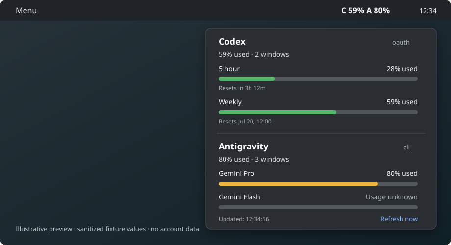

# Codex, Antigravity & Devin Usage

[English](README.md) | 日本語

[CodexBar](https://github.com/steipete/CodexBar) Linux CLIから、OpenAI Codex、Google Antigravity、Devinの
クォータ使用量を表示するLinux Mint Cinnamon用パネルアプレットです。providerごとに独立して
更新するため、一つの取得に失敗しても、他の正常なデータは表示され続けます。



_匿名化fixtureの値から作成した説明用プレビューです。アカウント情報は含まれていません。_

## 機能

- Codex、Antigravity、Devinの使用率または残量を、省スペースのパネルテキストで表示
- CodexBarの表示名を使い、モデルグループ別のクォータ枠とリセット時刻を表示
- `usage.primary`を代表値と仮定せず、既知windowのうち使用率が最大のものをサマリーに採用
- 0%、使用量不明、staleデータ、初回エラーを明確に区別
- providerごとの独立したエラー、最終正常値、手動更新、25秒timeout
- OAuth、Cookie、認証情報、Google内部API、localhost language serverへ直接アクセスしない設計

## 必要環境

- Linux Mint Cinnamon、またはローカルアプレットをサポートするCinnamonデスクトップ
- [CodexBar Linux CLI](https://github.com/steipete/CodexBar/blob/main/docs/cli.md)
- Codexクォータ取得用にサインイン済みのCodex CLI
- Antigravityクォータ取得用にサインイン済みのAntigravityまたは`agy`
- LinuxでDevinクォータを取得する場合はCodexBar v0.60.0以降
- CodexBarがローカルのAntigravityを検出するための`lsof`
- 任意: 詳細な匿名化診断JSONを表示するための`jq`
- 開発時のみ任意: Node.js 18以降

LinuxでDevinを使う場合はCodexBar v0.60.0以降を使用してください。リリース成果物は
[公式リリースページ](https://github.com/steipete/CodexBar/releases)からのみ取得し、インストール前に
隣接するSHA256ファイルを使ってarchiveを検証してください。

Linux版のCodexBar CLI v0.84.0で、Codex、Antigravity、Devinの使用量取得を確認しています。

アプレットをインストールする前に、backendを確認します。

```bash
command -v codexbar
codexbar --version
codexbar config validate --format json --pretty
codexbar usage --provider codex --format json --pretty
codexbar usage --provider antigravity --source auto --format json --pretty
codexbar usage --provider devin --format json --pretty
```

CodexBarがCinnamonプロセスのPATH外にある場合は、アプレット設定で絶対パスを指定してください。
アプレットはログインシェルを起動せず、`~/.local/bin/codexbar`や
`/opt/apps/codexbar/codexbar`などの一般的な配置先も確認します。

## インストール

このcheckout内で実行します。

```bash
./scripts/install.sh
```

続いて、**システム設定 → アプレット**を開き、**Codex, Antigravity & Devin Usage**を選択して
パネルへ追加します。アプレットを更新したら、Cinnamonを再起動してください。Cinnamon 6.6.9では、
アプレットだけを再読み込みすると、キャッシュされたJavaScriptモジュールが残る場合があります。

installerが作成するのは、次のsymlinkだけです。

```text
~/.local/share/cinnamon/applets/codex-agy-usage@local
```

同じcheckoutに対しては冪等です。実ディレクトリは置換せず、別のcheckoutを指すsymlinkを
置換する場合だけ`--force`が必要です。

アンインストールするには、次を実行します。

```bash
./scripts/uninstall.sh
```

アンインストールしても、CodexBar、Codex CLI、Antigravity、`agy`、設定、認証情報は削除されません。

## 設定

| 設定 | 既定値 | 説明 |
| --- | --- | --- |
| CodexBar command path | `codexbar` | 実行ファイル名または明示的なパス |
| Show Codex | On | Codexの更新と表示を有効化 |
| Show Antigravity | On | Antigravityの更新と表示を有効化 |
| Show Devin | On | Devinの更新と表示を有効化 |
| Refresh interval | 60秒 | 30〜3600秒、30秒単位 |
| Displayed percentage | Used | 使用率と残量の表示を切り替え |

内部のクォータ値は常に`usedPercent`として保持されます。そのため、残量を表示している場合でも、
警告色はクォータ消費の逼迫度を示します。

## Devinの動作と設定

CodexBarは`app.devin.ai`からDevinの日次・週次クォータを取得します。LinuxではChromeセッションの
自動取り込みが使えないため、CodexBarにBearer tokenと内部organization IDを手動設定してください。

```json
{
  "version": 1,
  "providers": [{
    "id": "devin",
    "cookieSource": "manual",
    "cookieHeader": "Bearer YOUR_DEVIN_TOKEN",
    "workspaceID": "org_YOUR_ORGANIZATION"
  }]
}
```

tokenはCodexBarの設定ファイルに保存するか、`DEVIN_BEARER_TOKEN`と`DEVIN_ORG`を使ってください。
アプレットがDevinの認証情報を直接読み書きすることはありません。tokenとorganization IDの取得方法は
[CodexBarのDevin設定ガイド](https://raw.githubusercontent.com/steipete/CodexBar/main/docs/devin.md)を参照してください。

## Antigravityの動作と制約

provider検出、認証、TLS、Antigravity protocolの処理はCodexBarが担当します。`auto`モードでは、
Antigravityアプリ、`agy` CLI、IDE language server、または設定済みOAuthが使用される場合があります。
ローカル取得には、Antigravityアプリまたは`agy`が利用可能であることが必要な場合があります。
OAuthでアカウントを識別できてもGoogleからクォータ上限が返されない場合は、
**Signed in; limits unavailable**と表示します。

Antigravityでは、**Gemini 5-hour**や**Gemini weekly**などの名前付きクォータ枠が
代表枠としても返る場合、名前付きの枠を1回だけ表示します。

使用率を返さず、リセット時刻だけを返すwindowもあります。この場合は**Usage unknown**として表示し、
0%、100%、警告のいずれとしても扱いません。Antigravity内部protocolは変更される可能性があり、
互換性対応は主にこのアプレットではなくCodexBar側で行われます。

## トラブルシューティングと診断

プライバシーに配慮した診断スクリプトを実行します。

```bash
./scripts/diagnose.sh
./scripts/diagnose.sh --command /absolute/path/to/codexbar
```

`jq`がある場合は、provider JSON内の機密キーを再帰的に伏せてから表示します。`jq`がない場合は、
provider、source、usageの有無、errorの有無だけを表示します。未加工のstderrは表示しません。
次のログも確認できます。

```bash
journalctl --user -f | grep -Ei 'cinnamon|codex|antigravity|devin'
tail -n 200 ~/.xsession-errors
```

主なパネルメッセージ:

- `CodexBar CLI not found`: command pathを設定するかCodexBarをインストールしてください
- `Start Antigravity or agy`: Antigravityのsourceを起動するかサインインしてください
- `Signed in; limits unavailable`: アカウントは認識されましたが、クォータ情報を取得できませんでした
- `Invalid CodexBar JSON`: 設定したcommandを手動で実行して出力を確認してください
- 末尾の`~`: 最後に取得できた正常値をstaleデータとして表示しています

## プライバシーとセキュリティ

アプレットはargv配列を使ってCodexBarを起動します。`sh -c`の使用、認証ファイルの読み取り、tokenの保存、
ブラウザの起動、GoogleまたはOpenAIへの直接接続、認証情報ディレクトリの走査、telemetry送信は行いません。
provider JSONとアカウント情報はメモリ内にだけ保持し、ログや永続ストレージへ保存しません。
エラーは匿名化し、最大300文字に制限します。

取得したテストfixtureでは`user@example.invalid`を使用し、一意な識別子を伏せています。
新しく取得したデータをレビューまたはcommitする前に匿名化するには、次を実行します。

```bash
node scripts/sanitize-fixture.js /secure/path/raw.json tests/fixtures/new-sanitized.json
```

未加工の取得データは絶対にcommitしないでください。

## 開発とテスト

Cinnamon実行時に使用するのはGJSだけであり、Node.jsはruntime dependencyではありません。
純粋な正規化・formatting moduleは、テスト専用の小さなCommonJS bridgeを公開しています。

```bash
npm test
node --check applet.js
bash -n scripts/install.sh scripts/uninstall.sh scripts/diagnose.sh
```

normalizerは、単一objectとarray、providerの完全一致、現行のnested named window、既知の旧path、
欠落field、使用量不明、追加field、不正JSON、partial errorを受理します。任意のobjectを無制限に
再帰探索してpercentを探すことは意図的に行いません。

## upstreamとライセンス

このプロジェクトは、
[jacobcalvert/codexbar-cinnamon-applet](https://github.com/jacobcalvert/codexbar-cinnamon-applet)の
commit `2b5ad38fb49aff4ad1d2eb4dc9781eb200a38b4d`を基にしています。元のMIT copyright表示は
[LICENSE](LICENSE)に保持しています。使用量の取得は、同じくMITライセンスの
[steipete/CodexBar](https://github.com/steipete/CodexBar)へ委譲しています。

基になったアプレットとの主な違いは、複数providerの同時表示、独立した更新状態、schemaの差異に
対応する正規化層、全windowの表示、unknown・staleの表現、安全なcommand探索、テスト、
配布・診断toolingです。
